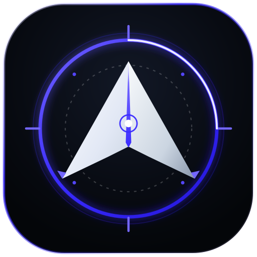
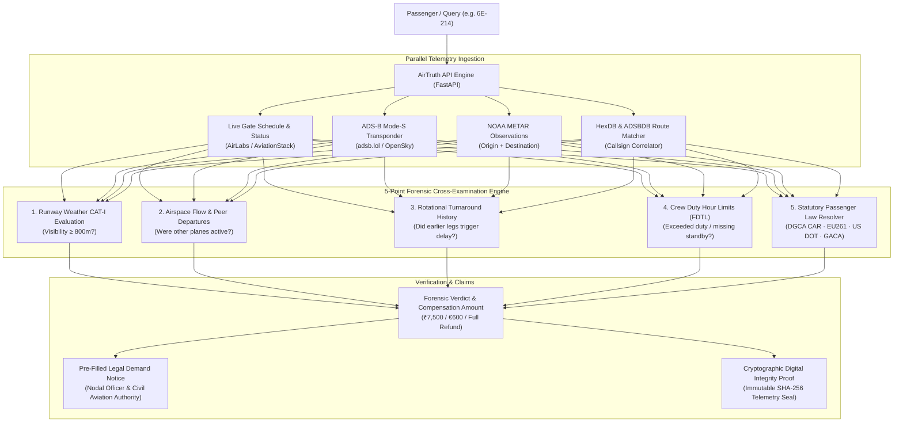

# ✈️ AIRTRUTH — Real-Time Flight Delay Forensic Engine & Statutory Payout Resolver

<p align="center">
  
</p>

<p align="center">
  <b>Never let airlines blame "Bad Weather" for operational delays.</b><br>
  <i>An autonomous, open-source aviation telemetry platform that cross-examines airline excuses against live NOAA METAR observations, Mode-S ADS-B transponder feeds, and aircraft rotational history to generate court-ready statutory passenger compensation claim packets.</i>
</p>

<p align="center">
  <a href="#-the-problem"></a>
  <a href="#-supported-jurisdictions"></a>
  <a href="#-quickstart"></a>
  <a href="#-quickstart"></a>
  <a href="#-docker--deployment"></a>
  <a href="LICENSE"></a>
</p>

---

## 🛑 The Problem

Every day, thousands of passengers endure 3 to 6-hour flight delays or sudden cancellations. Under international passenger rights laws (**India DGCA CAR**, **EU Regulation 261/2004**, **UK261**, **US DOT 14 CFR Part 260**, and **Saudi GACA**), airlines are legally mandated to pay **up to ₹10,000 / €600 / $650 in cash compensation**.

To evade these statutory payouts, airlines routinely dispatch boilerplate text messages claiming:
> *"Your flight is delayed due to adverse weather conditions and ATC operational restrictions."*

Because adverse weather is legally classified as an "extraordinary circumstance", passengers are left powerless—unable to verify whether runway visibility was actually below legal safety minimums, or whether the airline was masking an internal operational failure.

---

## ⚡ The Solution: AirTruth

**AirTruth strips away airline deflection by fusing four independent, non-carrier telemetry streams into a single forensic timeline:**

1. **NOAA METAR Runway Weather**: Pulls official WMO airport meteorological reports at departure and arrival at the exact minute of the incident. It evaluates runway visual range (RVR) against Category-I ILS takeoff/landing minimums ($\ge 800\text{m}$ visibility / $\ge 200\text{ft}$ ceiling).
2. **Airspace & Peer Flow Radar**: Tracks live 25 NM radius radar around the airport via ADS-B. If 15+ peer aircraft departed normally off the same runway, the "weather shutdown" excuse is scientifically refuted.
3. **Aircraft Turnaround & Rotational Leg History**: Traces the assigned aircraft tail registration (e.g. `VT-IFU`, `N842DN`, `G-XWBA`) across its prior 4 flight legs of the day. If the aircraft arrived late 6 hours earlier due to maintenance or baggage bottlenecks in another city, AirTruth proves the delay is a **cascading rotational carrier delay**—an airline operational liability.
4. **Crew Duty Hour Expiry (FDTL)**: Detects expired pilot/cabin crew Flight Duty Time Limits where the carrier failed to position reserve standby crews.
5. **Court-Ready Statutory Claim Generator**: Instantly outputs a pre-filled, formal legal demand letter addressed to the airline’s appellate authority and civil aviation regulators, stamped with a tamper-proof SHA-256 digital proof seal.

---

## 🏛️ System Architecture



---

## 🌟 Key Capabilities

### 🔍 Automatic Flight & Airport Resolution
* **Zero Airport Codes Required**: Users can simply type their flight code (e.g., `6e6467`, `QP1803`, `BA117`, `DL418`). AirTruth automatically detects the scheduled or airborne route, auto-populates the airport codes, and fetches both departure and arrival observations simultaneously.
* **Universal Regional & Proximity Weather Fallback**: Over 35+ regional domestic airports without direct NOAA stations (such as Ayodhya `AYJ`, Jammu `IXJ`, Shillong `SHL`, etc.) are mapped to certified regional hubs or resolved via real-time geodesic proximity.

### 🚨 Prominent Flight Cancellation Handling
* **Dual Statutory Entitlement**: For cancelled flights, fake gate pushback times are completely eliminated. The UI displays an alert verdict with bold grounding visual markers and establishes dual passenger rights: **100% immediate full ticket refund PLUS statutory cancellation compensation**.

### 🛫 Dynamic Radar Flight Track
* **Live Telemetry Progress**: The flight track dynamically positions the aircraft marker from 0% at departure gate to the exact telemetry progress percentage en route, snapping to 100% emerald upon landing or switching to an alert marker upon cancellation.

### 📜 Tamper-Proof Cryptographic Evidence
* Every audit packet binds the raw NOAA METAR string, transponder coordinates, and rotational delay findings under an immutable **SHA-256 cryptographic seal** that can be attached directly to formal airline legal appeals or court filings.

---

## 🌐 Supported Passenger Jurisdictions

| Jurisdiction | Primary Statute | Standard Delay Threshold | Maximum Statutory Payout | Cancellation Rights |
| :--- | :--- | :---: | :---: | :---: |
| **India** | **DGCA CAR Section 3, Series M Part IV** | 2 to 3+ hours | **₹5,000 – ₹10,000** | Full Refund + ₹5,000–₹10,000 |
| **European Union** | **EU Regulation 261/2004** | 3+ hours | **€250 – €600** | Full Refund + €250–€600 |
| **United Kingdom** | **UK261 (Air Passenger Rights)** | 3+ hours | **£220 – £520** | Full Refund + £220–£520 |
| **United States** | **US DOT 14 CFR Part 260** | 3+ hours domestic / 6+ international | **Automatic Cash Refund + Amenities** | 100% Mandatory Cash Refund |
| **Saudi Arabia** | **GACA Executive Regulations** | 2 to 6+ hours | **Up to 200% Ticket Value** | Full Refund + Statutory Penalty |

---

## 🛠️ Technology Stack

* **Backend Engine**: Python 3.11+, [FastAPI](https://fastapi.tiangolo.com/), [Pydantic v2](https://docs.pydantic.dev/), AnyIO, Uvicorn.
* **Frontend Web Application**: [React 19](https://react.dev/), [TypeScript](https://www.typescriptlang.org/), [Vite](https://vitejs.dev/), SSR Prerendering, Lucide Icons.
* **Live Telemetry Feeds**:
  * NOAA Aviation Weather Center (WMO METAR international exchange)
  * adsb.lol / OpenSky Network (Mode-S transponder radius radar)
  * AirLabs & AviationStack APIs (Real-time gate and flight timetable schedules)
  * HexDB / ADSBDB (Callsign-to-route resolution)
* **Browser SDK**: Vanilla TypeScript Web Component (`<airtruth-flight>`) and React wrapper (`@airtruth/js/react`) with airline design tokens for white-label embedding.

---

## 🚀 Quickstart

### Prerequisites
* Python 3.11 or higher
* Node.js 20 or higher
* npm 10 or higher

### 1. Clone the Repository
```bash
git clone https://github.com/isitanand/airtruth.git
cd airtruth
```

### 2. Environment Configuration
Copy the template and configure your telemetry keys:
```bash
cp deploy/.env.example .env
```
*(AirTruth runs out-of-the-box with free public NOAA and ADS-B feeds. Adding an `AIRLABS_API_KEY` enables real-time gate departure schedules).*

### 3. Build Web Assets & SDK
```bash
# Build browser SDK
cd packages/airtruth-js && npm ci && npm run build

# Build React web application
cd ../../apps/web && npm ci && npm run build
cd ../..
```

### 4. Run the Local Server
```bash
# Set up Python virtual environment
python -m venv engine/.venv
source engine/.venv/bin/activate   # On Windows: .\engine\.venv\Scripts\Activate.ps1
pip install -e ".[dev]"

# Launch the unified server
python -m airtruth_engine serve --host 127.0.0.1 --port 8787
```

Visit **`http://localhost:8787`** in your browser.

---

## 🐳 Docker & Production Deployment

AirTruth features a production-ready, unified multi-stage `Dockerfile` that compiles the React frontend and runs the FastAPI telemetry backend inside a hardened, unprivileged container:

### Build and Run with Docker
```bash
# Build unified image
docker build -t airtruth:latest .

# Run container on port 8080
docker run --rm -p 8080:8080 -e PORT=8080 airtruth:latest
```

### Deploy to Cloud Platforms
* **Render / Railway / Fly.io**: Connect your GitHub repository and select **Docker**. The platform will detect the root `Dockerfile` and deploy a unified instance serving both the frontend and backend under a single URL.
* **Vercel**: The repository includes a pre-configured `vercel.json` routing static assets to `apps/web` and serverless API endpoints to `app.py`.
* **Google Cloud Run**: Execute `deploy/cloudrun/deploy.sh` to build and deploy to Google Cloud Run in a single step.

---

## 📡 API Reference

### Flight Delay & Telemetry Audit
```http
POST /v1/flights/lookup
Content-Type: application/json

{
  "query": "6E-214",
  "flight_date": "2026-11-13",
  "origin": "DEL",
  "dest": "BLR",
  "claimed_reason": "weather",
  "delay_status": "over_3h"
}
```

#### Sample Response:
```json
{
  "mode": "live_metar_charter_audit",
  "provenance": "Live Schedule (AirLabs) + Origin Weather (NOAA) + Airspace Traffic (Radar)",
  "schedule_verified": true,
  "delay_status": "over_3h",
  "flight": {
    "flight_code": "6E-214",
    "airline": "IndiGo",
    "route": "DEL → BLR",
    "tail_number": "VT-IFU",
    "delay_minutes": 245,
    "statute": "DGCA CAR Section 3, Series M Part IV"
  },
  "excuse_vs_truth": {
    "airline_claimed": "weather",
    "excuse_rebutted": true,
    "true_root_cause_title": "Crew Duty Hour Expiry (FDTL)",
    "true_root_cause_detail": "Aircraft VT-IFU experienced an upstream crew duty timeout in Mumbai (12.2h/12.0h FDTL) with no standby crew positioned. Departure and arrival airports operated with nominal flyable visibility (>2,700m)."
  },
  "compensation": {
    "amount": 7500,
    "amount_display": "₹7,500",
    "statute": "DGCA CAR Section 3, Series M Part IV",
    "regulator": "DGCA AirSewa"
  },
  "claim_packet": {
    "packet_id": "AT-6E214-9B2F1C",
    "signature_sha256": "e3b0c44298fc1c149afbf4c8996fb92427ae41e4649b934ca495991b7852b855"
  }
}
```

---

## 📄 License

This project is licensed under the **Apache License 2.0** — see the [LICENSE](LICENSE) file for details.

---

<p align="center">
  <b>AirTruth</b> — Defending passenger rights with independent, immutable aviation data.
</p>
